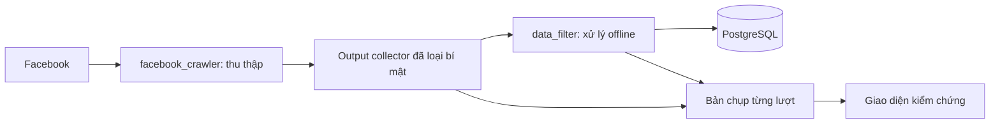

# Kiểm chứng bộ cào qua giao diện

Ưu tiên hiện tại là kiểm chứng bộ cào Facebook. Bộ lọc nghiệp vụ guitar/giá chưa được bổ sung. Hai module mã nguồn có thể chạy độc lập, cùng được điều phối bởi ứng dụng:



`facebook_crawler` quản lý session, truy cập, phân trang, giới hạn thời gian và output đầu vào. Module này giữ cả các dòng trùng và ngoài cửa sổ để kiểm tra. `data_filter` chuẩn hóa offline, kiểm tra ID/URL/thời gian, quy tắc tìm kiếm và fingerprint hiện có; không cần cookie, kết nối Facebook hay database. Adapter POC và normalizer cũ tiếp tục được tái sử dụng. Đây là hai module nghiệp vụ trong cùng repository, không yêu cầu hai server.

## Mở giao diện

Trong WSL, dừng ứng dụng bằng Ctrl+C rồi cập nhật:

```bash
cd /mnt/c/projects/Guitar-Radar
git pull --ff-only origin main
bash scripts/phase1.sh setup
bash scripts/phase1.sh start
```

Mở http://localhost:8000, đăng nhập bằng thông tin local trong `.env.phase1`. Tab mặc định **Kiểm chứng bộ cào** dùng để kiểm tra dữ liệu. Schema mới được cập nhật tự động; bài/feed đã lưu được giữ.

## Xem lại các lượt đã benchmark

Bấm **Nhập lượt đã lưu**. Ứng dụng đọc các ID trong `reports/stability.json`, metadata và `facebook-go.raw.json` tại `data/runs/<run-id>/`. Thao tác này không gọi Facebook, không sửa raw gốc và không đưa lại bài vào feed. Nhập lặp lại bỏ qua lượt đã có. Group mới tạo bởi import bị tắt để tránh tự khởi động lịch thu thập. Fixture `evaluated_known_posts` đã xác nhận trong report cũng được nhập khi khớp group.

CLI tương đương:

```bash
.venv/bin/python -m radar import-validation
```

Nếu thiếu manifest hoặc raw ở máy hiện tại, giao diện báo lỗi nhập; không lấy số liệu tổng hợp làm bằng chứng thay cho raw.

## Kiểm tra từng lượt và độ ổn định

- Xem số dòng đầu vào, số bài sau chuẩn hóa, trạng thái success/partial/failed, cửa sổ thời gian, ID thiếu/trùng và tỉ lệ các trường **có dữ liệu**.
- Mở chi tiết từng bài để xem caption, tác giả, permalink, thời điểm đăng và ảnh; so với output collector đầu vào đã loại bí mật.
- Những bản ghi đầu vào chưa có trong dữ liệu chuẩn hóa hiển thị riêng để điều tra bài ngoài cửa sổ hoặc lỗi xử lý.
- Chọn group và một FROM/TO cố định bằng giờ Việt Nam. Chạy lượt đầu, chờ xong rồi **Lặp lại cùng cửa sổ**. Chỉ các lượt cùng numeric group, nguồn, FROM/TO và hoàn tất không lỗi mới được so sánh.

Giao diện chỉ ra bài biến mất/xuất hiện hoặc trường thay đổi. `stable_in_observed_window` chỉ nghĩa các mẫu so sánh giống nhau: hai lượt cùng bỏ sót một bài vẫn có thể giống nhau. Facebook cũng có thể sửa/xóa bài giữa các lượt. Lượt cũ không có bản chụp được báo chưa có bằng chứng chi tiết.

## Đối chiếu bài và thông tin đã biết

Nhập permalink của bài từ đúng group, thời gian đăng đã xác nhận và kỳ vọng có ảnh. Có thể thêm toàn bộ nội dung chuẩn cùng số ảnh đã xác nhận. Dùng URL `/groups/<id-or-alias>/posts/<post-id>/` hoặc `/permalink/<post-id>/`; link `share/p` cần resolve trước bằng công cụ validation hiện có.

Kết quả phân biệt có bài, thiếu bài đã xác nhận trong cửa sổ, ngoài cửa sổ, thiếu mốc thời gian, thiếu ảnh, nội dung khác bản chuẩn hoặc số ảnh khác kỳ vọng. Bài đã thấy trong cửa sổ nhưng chưa có mốc độc lập vẫn có thể xác nhận sự hiện diện; bài không thấy và không có thời gian chuẩn chưa đủ căn cứ để kết luận bị bỏ sót.

**Có dữ liệu không đồng nghĩa đầy đủ.** Nếu chưa nhập nội dung/số ảnh chuẩn, độ đầy đủ caption/gallery vẫn chưa được đối chiếu. URL ảnh có thể hết hạn.

### Ảnh có nhiều phiên bản kích thước

Collector chọn một phiên bản có diện tích pixel lớn nhất cho cùng `Photo.id`, giữ nguyên URL đã chọn và metadata nguồn. Với Photo thiếu ID, các trường rendition trong cùng node được gộp trước. Khi chỉ còn URL, chỉ các tên object ảnh Facebook CDN dạng số đã nhận diện mới được gộp qua khác biệt hostname hoặc tham số resize/chữ ký; URL trên host khác được giữ riêng nếu chưa có bằng chứng cùng một ảnh. Các Photo có ID khác nhau vẫn được giữ riêng.

Normalizer dùng cùng quy tắc nhận diện để xử lý các file raw cũ có nhiều URL rendition. Bản chụp của lượt đã lưu trong database giữ nguyên để bảo toàn bằng chứng lịch sử; chạy một lượt mới sau khi cập nhật collector để kiểm tra kết quả mới trên giao diện. `setup` build lại binary Go sau `git pull`, kể cả khi binary cũ đã tồn tại.

Các mẫu chỉ chứng minh kết quả trên những bài đã kiểm tra. Muốn đo recall toàn bộ cửa sổ, cần danh sách đầy đủ từ nguồn kiểm tra độc lập. Ứng dụng không tự suy ra danh sách Facebook đầy đủ từ chính output bộ cào.

## Chạy riêng hai module

Thu thập và xuất private JSON:

```bash
.venv/bin/python -m facebook_crawler --group 'https://www.facebook.com/groups/vegmpremium' --from '2026-11-06T00:00:00+07:00' --to '2026-11-08T11:41:46+07:00' --output data/collector-export.json
```

Chuẩn hóa offline:

```bash
.venv/bin/python -m data_filter --input data/collector-export.json --output data/processed-export.json
```

Tùy chọn lọc chỉ áp dụng khi được truyền rõ ràng; mặc định chỉ chuẩn hóa. Với file normalized, thêm `--normalized-input`. File chứa dữ liệu group, được đặt quyền riêng tư và bị Git bỏ qua.

Bản chụp output collector/normalized trong PostgreSQL được giữ để so sánh lịch sử và nằm trong backup. Không lưu cookie, authorization header hay HTML bootstrap; không bật raw debug GraphQL. Cần tính dung lượng database/backup khi giữ nhiều lượt.
