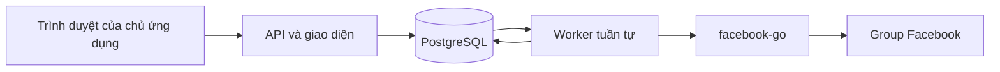

# Chạy Guitar Radar — Phase 1

Phase 1 có ứng dụng web riêng tư, PostgreSQL, worker thu thập tuần tự, lịch tùy chọn và duyệt bài trùng thủ công. `facebook-go` là collector chính. Python API dùng chung normalizer với POC; giao diện HTML/CSS/JavaScript không cần Node hay frontend build. `fbgql` tiếp tục dùng qua công cụ validation khi cần đối chiếu.

Ưu tiên mới là [giao diện kiểm chứng bộ cào](collector-verification.md). Module `facebook_crawler` tạo output đầu vào, module `data_filter` xử lý offline; worker nối hai module. Bản chụp collector đã loại bí mật và dữ liệu chuẩn hóa được lưu theo từng lượt để kiểm tra.



## Cài trong WSL Ubuntu

Cần Python 3.11+, collector đã build, và Docker với Compose v2. Trên Windows, cài/chạy Docker Desktop, bật **Settings → Resources → WSL Integration → Ubuntu**. Sau đó chạy các lệnh dưới trong terminal Ubuntu, không phải PowerShell:

```bash
cd /mnt/c/projects/Guitar-Radar
git pull --ff-only origin main
bash scripts/phase1.sh setup
```

Setup cài các package đã pin, build lại collector Go để áp dụng thay đổi sau `git pull`, tạo `.env.phase1` với mật khẩu ngẫu nhiên nếu chưa có, khởi động PostgreSQL cổng `127.0.0.1:54329`, tạo schema và group pilot `vegmpremium`. Setup không gọi Facebook và không ghi đè `.env` hay `.env.phase1` đã có.

Nếu đã có PostgreSQL riêng, không cần Compose: cài `radar/requirements.txt`, chạy `.venv/bin/python -m radar init-config`, sửa `RADAR_DATABASE_URL` trong `.env.phase1` trỏ tới database riêng rồi chạy `.venv/bin/python -m radar bootstrap`.

Mở `.env.phase1` trong editor để lấy `RADAR_USERNAME` và `RADAR_PASSWORD`. Đây là tài khoản đăng nhập ứng dụng, khác cookie Facebook. Giữ file này riêng tư.

```bash
bash scripts/phase1.sh start
```

Mở **http://localhost:8000** trong trình duyệt Windows, nhập tài khoản trên. Terminal cần chạy trong lúc dùng ứng dụng; Ctrl+C dừng API và worker. Database vẫn lưu trong Docker volume qua các lần khởi động.

Nếu cổng 54329 đang dùng, sửa `RADAR_DB_PORT` và cổng trong `RADAR_DATABASE_URL` ở `.env.phase1` cho khớp. Nếu volume đã được tạo với mật khẩu cũ, thay file env không tự đổi mật khẩu PostgreSQL: giữ giá trị gốc hoặc đổi mật khẩu role trong database. Không xóa volume để chữa lỗi kết nối nếu cần giữ dữ liệu.

## Thu thập lần đầu

1. Giữ session hợp lệ trong `.env`/`FACEBOOK_COOKIE_FILE` theo hướng dẫn POC. Không nhập cookie vào giao diện, Git hay chat.
2. Mở tab **Groups**, kiểm tra pilot, bấm **Thu thập**. Có thể thêm các group khác bằng URL hoặc numeric ID mà tài khoản có quyền đọc.
3. Xem trạng thái trong tab **Lịch sử**. Một worker xử lý các lượt theo thứ tự; group đang chờ/chạy không được xếp thêm lượt trùng.
4. Mở **Bảng tin** để tìm kiếm, lọc group/ngày/có ảnh. Các ngày trên giao diện dùng giờ Việt Nam và gửi mốc có múi giờ tới API.

Mặc định mỗi lượt nhìn lại 72 giờ, tối đa 50 trang × 20 bài; đây là cửa sổ hữu hạn, không phải backfill toàn bộ group. Lượt chạm giới hạn trang hoặc lỗi giữa chừng được ghi partial; bài hợp lệ đã có vẫn được lưu. Nếu worker bị dừng bất thường, lượt running được đánh dấu interrupted khi worker mới có quyền chạy. Lặp lại collection cập nhật bài có cùng ID, giữ thời điểm thấy lần đầu và không tạo bản sao.

## Lịch chạy và phiên hết hạn

`RADAR_INTERVAL_SECONDS=0` là chế độ thủ công. Để bật lịch, sửa `.env.phase1`, ví dụ `RADAR_INTERVAL_SECONDS=1800`, rồi khởi động lại ứng dụng. Khoảng cách tối thiểu là 900 giây; các group vẫn chạy tuần tự. `RADAR_LOOKBACK_HOURS` điều chỉnh lookback 1–720 giờ. Lịch có thể chạy ngay khi khởi động nếu group chưa có lượt thành công gần đây.

Nếu Facebook báo hết phiên, checkpoint, hạn chế tài khoản hoặc rate limit, worker dừng thu thập cho toàn bộ tài khoản. Xử lý thủ công trên Facebook, cập nhật session local rồi bấm **Tiếp tục**. Các giá trị đã export trước khi khởi động được ưu tiên hơn file; nếu muốn dùng `.env`, dừng app, chạy `unset FACEBOOK_COOKIE FACEBOOK_COOKIE_FILE FACEBOOK_USER_ID` và khởi động lại. Session lấy từ file được đọc lại cho từng lượt.

Khi tạm dừng, thông báo xuất hiện phía trên mọi tab cùng nút **Tiếp tục**; nút thu thập và lặp lại lượt bị khóa. Cập nhật cookie không tự xóa trạng thái tạm dừng: sau khi xử lý phiên, bấm **Tiếp tục** rồi tạo lượt mới. API trả `409 Conflict` nếu tài khoản còn tạm dừng, group đang tắt hoặc group đã có lượt chờ/chạy; xem thông báo trên giao diện để xử lý đúng nguyên nhân.

Worker và API có thể tách riêng: `.venv/bin/python -m radar serve --no-worker` và `.venv/bin/python -m radar worker`. Khóa PostgreSQL ngăn hai worker cùng chạy. Khi mất kết nối giữ khóa, worker ngừng tiến hành collection; worker thay thế chờ heartbeat cũ hết hạn trước khi khôi phục lượt.

## Duyệt bài đăng trùng

Cùng post ID/permalink được lưu đúng một nguồn bài. Bài từ các group khác nhau có nội dung giống hệt sau chuẩn hóa chữ/không gian và dài ít nhất 40 ký tự được đề xuất ở tab duyệt trùng. Chỉ thao tác xác nhận của chủ ứng dụng mới gộp các bài vào một listing. Feed sau gộp giữ các link Facebook nguồn; lọc theo một group vẫn tìm được listing nếu có nguồn thuộc group đó. Không có AI hoặc tự gộp các ID khác nhau.

## Bảo mật và vận hành

Ứng dụng mặc định chỉ lắng nghe `127.0.0.1` và yêu cầu HTTP Basic cho giao diện/API. Nếu chạy trên VPS hoặc cho người khác truy cập, dùng HTTPS ở reverse proxy/private network, cấu hình `RADAR_ALLOWED_HOSTS` và bind host phù hợp. Không đưa Basic Auth qua HTTP công khai. Phase 1 dành cho một chủ ứng dụng, chưa có đăng ký/multi-tenant.

API không hiển thị session và không bật CORS; thao tác ghi phải có header `X-Radar-Request: 1` từ giao diện. Database lưu bài, metadata ảnh và bản chụp output collector/normalized đã loại bí mật theo lượt; không lưu cookie, HTTP headers hay raw bootstrap. Ảnh được tải trực tiếp bởi trình duyệt từ URL nguồn, có thể hết hạn; link bài Facebook vẫn được giữ. Không tải về/rehost gallery.

## Sao lưu và khôi phục

```bash
bash scripts/phase1.sh backup
```

File SQL nằm trong `data/backups/`, quyền riêng tư và bị Git bỏ qua. Sao lưu chứa dữ liệu group; tự quản lý thời hạn lưu và nơi lưu backup. Dừng PostgreSQL khi không dùng bằng `bash scripts/phase1.sh stop-db`; chạy lại `setup` để khởi động, không làm mất volume.

Để kiểm tra backup, khôi phục vào **database mới**, không đè database đang chạy:

```bash
docker compose --env-file .env.phase1 -f compose.phase1.yml exec -T db createdb -U radar guitar_radar_restore
docker compose --env-file .env.phase1 -f compose.phase1.yml exec -T db psql -v ON_ERROR_STOP=1 -U radar -d guitar_radar_restore < data/backups/TEN_FILE.sql
```

Sau khi kiểm tra, có thể đổi tên database trong `RADAR_DATABASE_URL` để sử dụng bản khôi phục. Giữ mật khẩu database và app ngoài backup công khai.

## Kiểm thử

```bash
.venv/bin/python -m unittest discover -s tests -v
```

Các test API và worker dùng mock, không gọi Facebook. Test database thực chạy khi đặt `RADAR_TEST_DATABASE_URL` trỏ tới database thử riêng; mỗi test dùng schema riêng, không dùng database có dữ liệu cần giữ. Cài runtime ứng dụng trước khi chạy root tests. Các test collector/validation cũ tiếp tục chạy theo README POC.

Kiểm thử luồng tạm dừng/tiếp tục của JavaScript bằng DOM giả lập (tùy chọn, cần Node): `npm install --prefix .cache/ui-tests --ignore-scripts --no-audit --no-fund jsdom@26.1.0`, rồi `node --test tests/collection_ui.test.cjs`. Test chỉ dùng phản hồi synthetic, không cần database hay Facebook.

Kiểm thử trình duyệt tự động dùng `tests/phase1_browser_smoke.py`, cần `tests/requirements-browser.txt`, Chromium đã cài (`RADAR_CHROMIUM` nếu đường dẫn khác `/usr/bin/chromium`) và database thử riêng qua `RADAR_TEST_DATABASE_URL`. Script tự tạo/xóa schema, chỉ dùng bài synthetic, không gọi Facebook; ảnh chụp desktop/mobile lưu trong `reports/`.

Phase 1 không tự chuyển cookie của bạn lên Cloud và không cam kết luôn lấy đủ feed Facebook. Sau khi thử giao diện/collection trên WSL, đánh giá số lượng bài, các lượt partial và điều kiện vận hành trước khi mở rộng group/lịch chạy.
